# Class Activity 1 — System Calls in Practice

- **Student Name:** CHEA Pisth
- **Student ID:** e20230248
- **Date:** 10/19/2026

---

## Warm-Up: Hello System Call

Running `hello_syscall.c` on Linux:

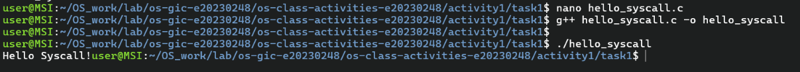

Screenshot of running `hello_winapi.c` on Windows (CMD/PowerShell/VS Code):

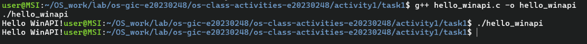

Screenshot of running `copyfilesyscall.c` on Linux:

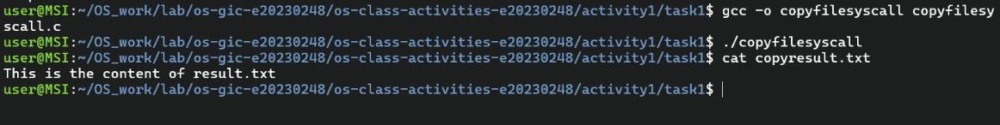

---

## Task 1: File Creator & Reader

### Part A — File Creator

**Describe implementation:**

> • Library Call: Executes in user mode with the same standard privileges as your application code. No mode switching happens when you call a library function.
> • System Call: Executes in kernel mode

**Version A — Library Functions (`file_creator_lib.c`):**

<!-- Screenshot: gcc -o file_creator_lib file_creator_lib.c && ./file_creator_lib && cat output.txt -->

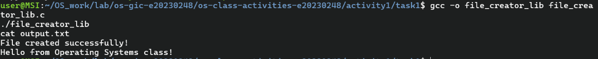

**Version B — POSIX System Calls (`file_creator_sys.c`):**

<!-- Screenshot: gcc -o file_creator_sys file_creator_sys.c && ./file_creator_sys && cat output.txt -->


**Questions:**

1. **What flags did you pass to `open()`? What does each flag mean?**

   > Passed the flags O_WRONLY | O_CREAT | O_TRUNC to open(). O_WRONLY opens the file in write-only mode, O_CREAT creates the file if it does not exist, and O_TRUNC clears the file's existing contents if it already exists. The flags is allow the program to create or overwrite output.txt and write new data into it.

2. **What is `0644`? What does each digit represent?**

   > 0644 is permmission,It means the file owner can read and write, while everyone else can only read the file.

3. **What does `fopen("output.txt", "w")` do internally that you had to do manually?**
   > fopen("output.txt", "w") internally performs the file opening system call (open()), creates a buffered stream (FILE \*), and manages buffering and file state . In the system call version,It had to explicitly use open(), specify flags, write data, and close the file .

### Part B — File Reader & Display

**Version A — Library Functions (`file_reader_lib.c`):**

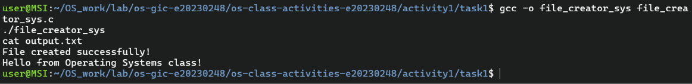

**Version B — POSIX System Calls (`file_reader_sys.c`):**


**Questions:**

1. **What does `read()` return? How is this different from `fgets()`?**

   > read() returns the number of bytes read, 0 for EOF, and -1 for errors.
   > And fgets() returns a pointer to the string read (or NULL on EOF/error).

2. **Why do you need a loop when using `read()`? When does it stop?**

   > It need a loop because read() reads only a portion of the data each time. The loop stops when read() returns 0 (EOF) or -1 (error)

---

## Task 2: Directory Listing & File Info

### Version A — Library Functions (`dir_list_lib.c`)

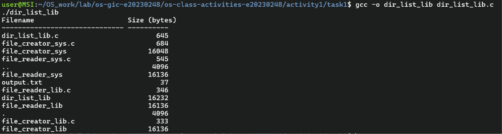

### Version B — System Calls (`dir_list_sys.c`)

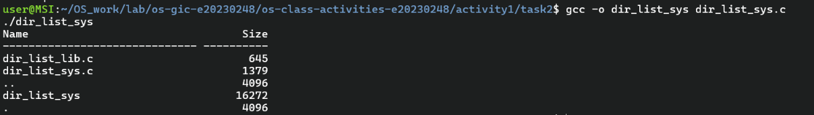

### Questions

1. **What struct does `readdir()` return? What fields does it contain?**

   > readdir() returns a pointer to a struct dirent.
   > It contain a directory entry.

2. **What information does `stat()` provide beyond file size?**

   > stat() provides much more than just the file size. It returns a structure containing metadata about a file.

3. **Why can't you `write()` a number directly — why do you need `snprintf()` first?**

   > write() can only write raw bytes to a file descriptor. It does not understand data types such as int, float, or double. snprintf() converts the number into a human-readable string before write() sends those bytes to the file or terminal.

---

## Optional Bonus: Windows API (`file_creator_win.c`)

Screenshot of running on Windows:


### Bonus Questions

1. **Why does Windows use `HANDLE` instead of integer file descriptors?**

   > Windows uses a HANDLE instead of a simple integer file descriptor because Windows treats many kinds of system resources in a unified way.

2. **What is the Windows equivalent of POSIX `fork()`? Why is it different?**

   > Windows has no direct fork(). It CreateProcess() instead, which starts a new program from an executable rather than cloning the caller. Why is it different?Because Windows was designed around creating processes from executable images, not cloning them. fork() duplicates the parent’s state and relies on copy-on-write memory, which fits the POSIX mode

3. **Can you use POSIX calls on Windows?**

   > POSIX calls on Windows through Cygwin, WSL, MinGW, or MSYS2, though each one handles them differently and with varying completeness.

---

## Task 3: strace Analysis

**Describe what you observed:**

> The strace ouput is it show about debugging and perfomnce of program. It has 35 call form ./file_reader_sys.

### strace Output — Library Version (File Creator)

<!-- Screenshot: strace -e trace=openat,read,write,close ./file_creator_lib -->
<!-- IMPORTANT: Highlight/annotate the key system calls in your screenshot -->

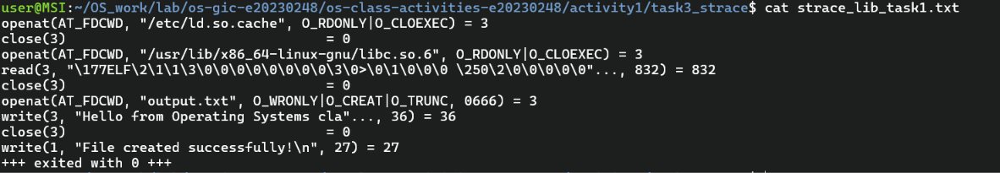

### strace Output — System Call Version (File Creator)

<!-- Screenshot: strace -e trace=openat,read,write,close ./file_creator_sys -->
<!-- IMPORTANT: Highlight/annotate the key system calls in your screenshot -->

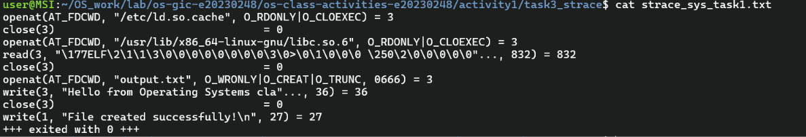

### strace Output — Library Version (File Reader or Dir Listing)

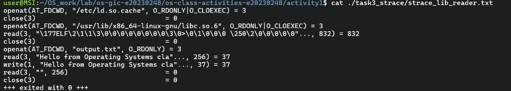

### strace Output — System Call Version (File Reader or Dir Listing)

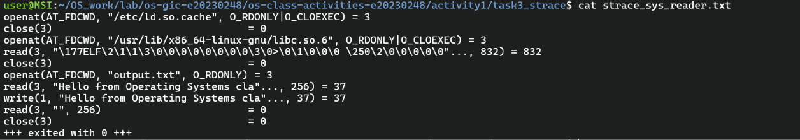

### strace -c Summary Comparison

<!-- Screenshot of `strace -c` output for both versions -->

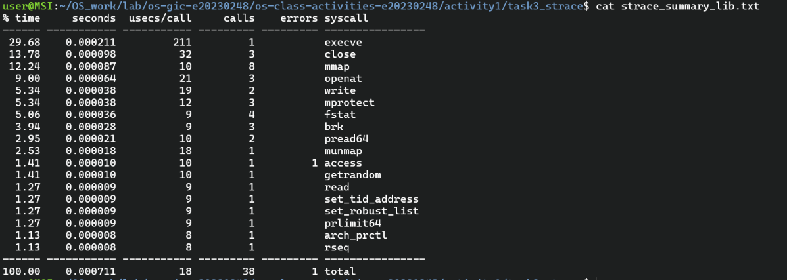
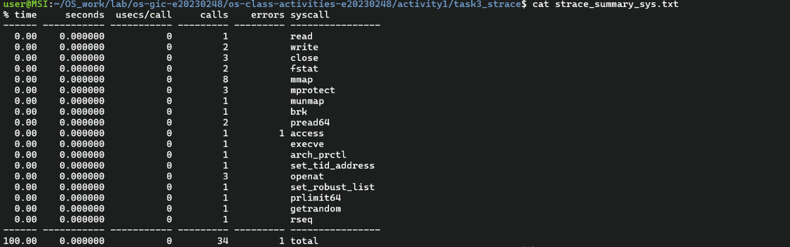

### Questions

1. **How many system calls does the library version make compared to the system call version?**

   > 35

2. **What extra system calls appear in the library version? What do they do?**

   > Extra calls in the library version: Both programs load libc, so startup calls like mmap, mprotect, openat, and arch_prctl appear in both. The library version adds calls for stdio buffering: fstat to check whether stdout is a terminal, which decides how output is buffered, and brk or mmap to allocate the buffer. Compare your library trace against this one to confirm.

3. **How many `write()` calls does `fprintf()` actually produce?**

   > It shows 1 write() call, e. fprintf() doesn’t . It fills a buffer, and the buffer is flushed when it’s full, when a newline is printed to a terminal (line buffering), or when the program exits. So the number of write() calls depends on buffering, not on the number of fprintf() calls.

4. **In your own words, what is the real difference between a library function and a system call?**

   > A library function runs in your program and may or may not call the kernel. A system call always goes to the kernel. Library functions often wrap system calls to make them easier to use: fprintf() formats text in user space, buffers it, and eventually calls write(), which is the system call that actually sends bytes to the file or terminal.

---

## Task 4: Exploring OS Structure

### System Information

> 📸 Screenshot of `uname -a`, `/proc/cpuinfo`, `/proc/meminfo`, `/proc/version`, `/proc/uptime`:

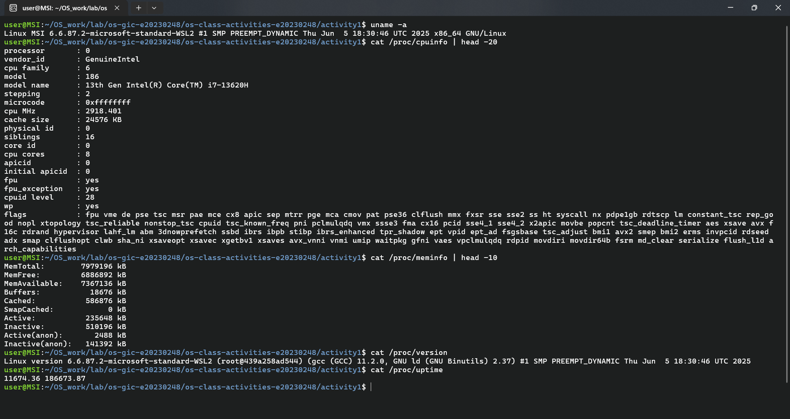

### Process Information

> 📸 Screenshot of `/proc/self/status`, `/proc/self/maps`, `ps aux`:

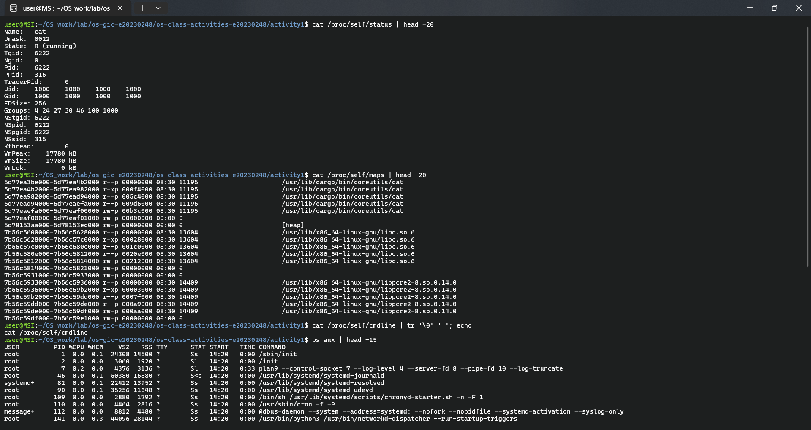

### Kernel Modules

> 📸 Screenshot of `lsmod` and `modinfo`:


### OS Layers Diagram

> 📸 Your diagram of the OS layers, labeled with real data from your system:

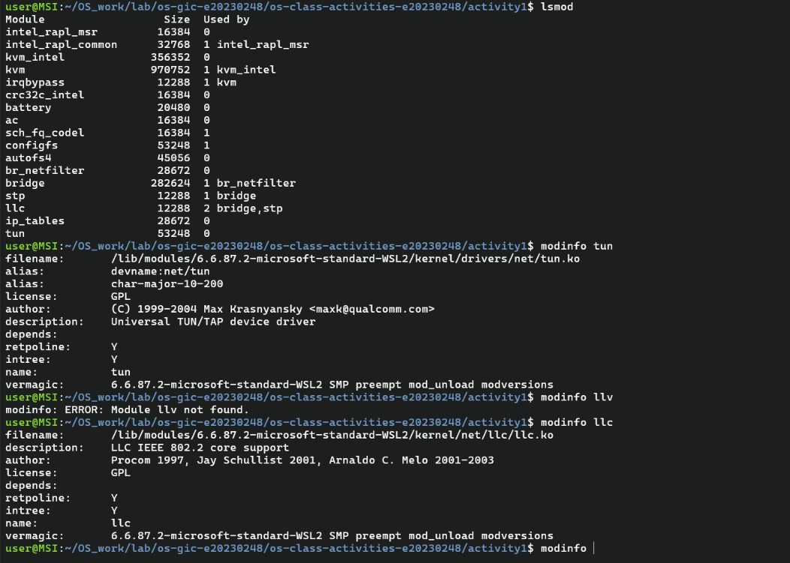

### Questions

1. **What is `/proc`? Is it a real filesystem on disk?**

   > `/proc` is a virtual filesystem (usually called procfs). It is not a real filesystem on disk. The Linux kernel generates its contents in memory when you read them, so it exists only while the system is running.

2. **Monolithic kernel vs. microkernel — which type does Linux use?**

   > Linux uses a monolithic kernel. Core services like scheduling, memory management, filesystems, drivers, and networking all run together in kernel space and call each other directly.

3. **What memory regions do you see in `/proc/self/maps`?**

   > `/proc/self/maps` describes one virtual memory region of the process that is reading the file.

4. **Break down the kernel version string from `uname -a`.**

   ```
    Linux MSI 6.6.87.2-microsoft-standard-WSL2 #1 SMP PREEMPT_DYNAMIC Thu Jun  5 18:30:46 UTC 2025 x86_64 GNU/Linux
    CPU info
        processor       : 0
        vendor_id       : GenuineIntel
        cpu family      : 6
        model           : 186
        model name      : 13th Gen Intel(R) Core(TM) i7-13620H
        stepping        : 2
        microcode       : 0xffffffff
        cpu MHz         : 2918.401
        cache size      : 24576 KB
        physical id     : 0
        siblings        : 16
        core id         : 0
        cpu cores       : 8
        apicid          : 0
        initial apicid  : 0
        fpu             : yes
        fpu_exception   : yes
        cpuid level     : 28
        wp              : yes
    Ram info
        MemTotal:        7979196 kB
        MemFree:         6879608 kB
        MemAvailable:    7365364 kB
        Buffers:           21420 kB
        Cached:           589540 kB
        SwapCached:            0 kB
        Active:           241064 kB
        Inactive:         507584 kB
        Active(anon):       2492 kB
        Inactive(anon):   138800 kB
    Linux version 6.6.87.2-microsoft-standard-WSL2 (root@439a258ad544) (gcc (GCC) 11.2.0, GNU ld (GNU Binutils) 2.37) #1 SMP PREEMPT_DYNAMIC Thu Jun  5 18:30:46 UTC 2025
    System uptime : 18181.02 290700.40
   ```

5. **How does `/proc` show that the OS is an intermediary between programs and hardware?**

   > `/proc` makes the OS’s role as an intermediary visible because almost every entry in it is a view that the kernel builds from its own bookkeeping, not from the hardware directly. Programs never see the raw device state.

---

## Reflection

What did you learn from this activity? What was the most surprising difference between library functions and system calls?

> Through this activity, I learned how programs interact with the operating system to create and read files. I saw that library functions such as `fopen()`, `fprintf()`, and `fgets()` provide a convenient interface, while POSIX system calls such as `open()`, `write()`, and `read()` require more direct handling of file descriptors and data. The most surprising difference was that a simple library call may perform additional work behind the scenes, while system calls give the programmer more control but require careful error handling and management.
