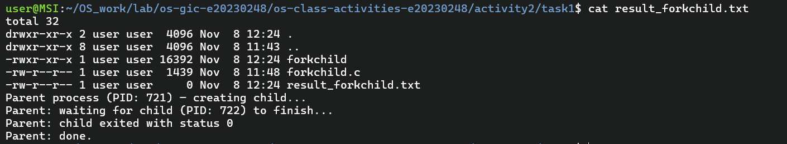
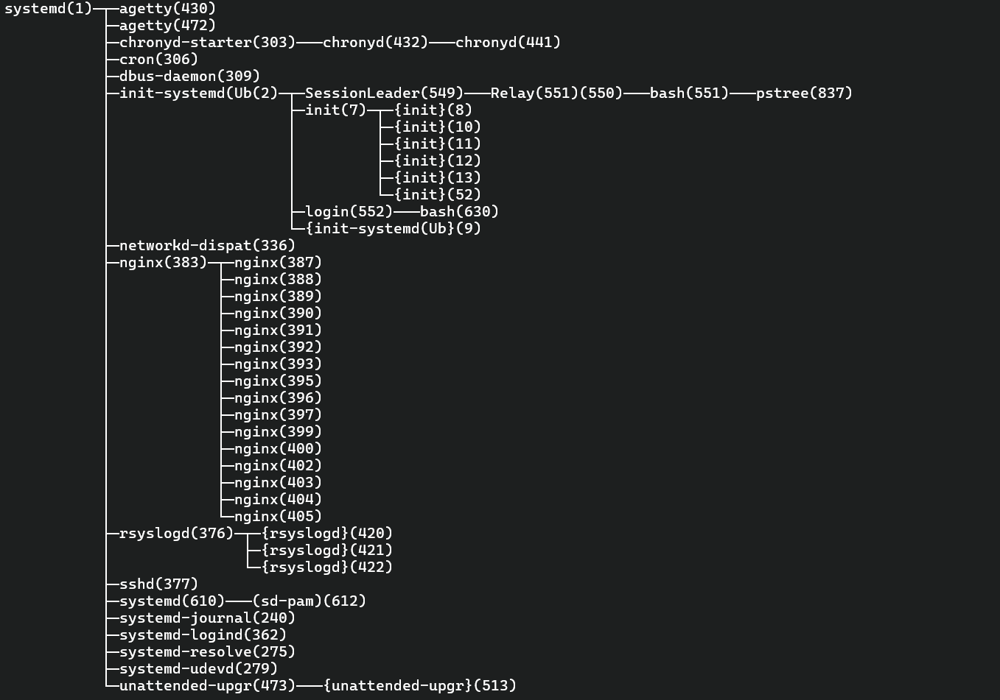
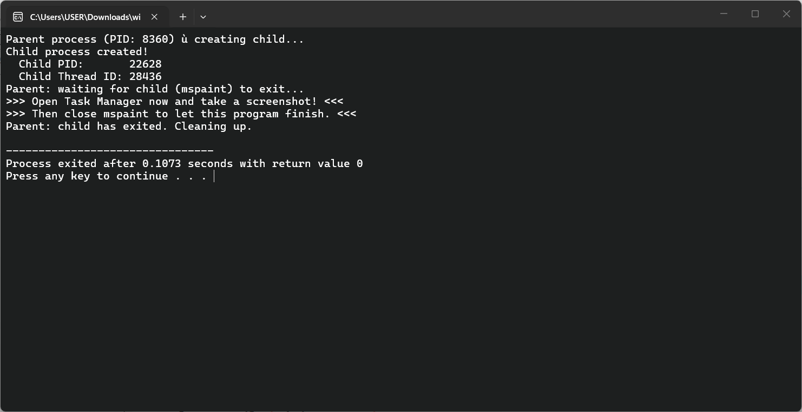
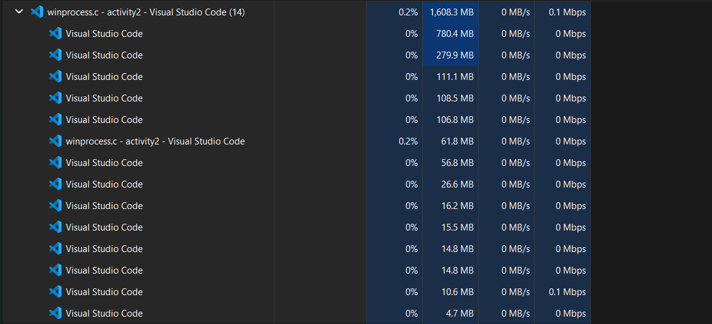
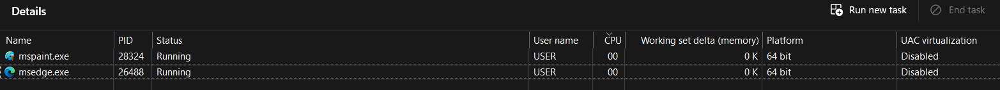
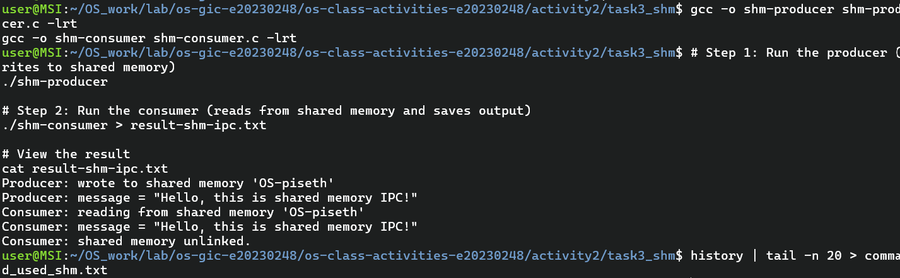
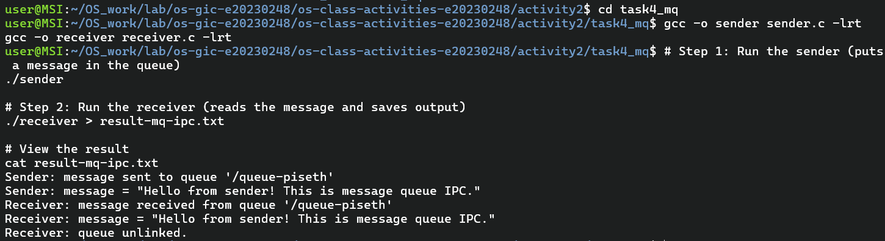

# Class Activity 2 — Processes & Inter-Process Communication

- **Student Name:** [Your Name Here]
- **Student ID:** [Your Student ID Here]
- **Date:** [Date of Submission]

---

## Task 1: Process Creation on Linux (fork + exec)

### Compilation & Execution

Screenshot of compiling and running `forkchild.c`:



### Process Tree

Screenshot of the parent-child process tree (using `ps --forest`, `pstree`, or `htop` tree view):



### Output

```
[Paste the content of result_forkchild.txt here]
```

### Questions

1. **What does `fork()` return to the parent? What does it return to the child?**

   > The `fork() ` rerurn to the parent process: The Process ID (PID) of the newly created child process. If the operation fails, it returns -1. and it return to the child process: 0

2. **What happens if you remove the `waitpid()` call? Why might the output look different?**

   > If removing the `waitpid()` call, the parent process will not block to wait for the child to finish. Instead, it will immediately evaluate the remaining code, print "Parent: done.", and terminate.

3. **What does `execlp()` do? Why don't we see "execlp failed" when it succeeds?**

   > `execlp()` replaces the current process's memory, code, and data with a completely new program. In your example, it tells the operating system to overwrite the child process with the ls program found in the system's PATH.

4. **Draw the process tree for your program (parent → child). Include PIDs from your output.**

   ```
   init / systemd (PID: 1)
       │
       └── bash
             │
             └── forkchild    <-- The Parent Process (waiting)
                   │
                   └── ls          <-- The Child Process (executing ls -la)

   ```

5. **Which command did you use to view the process tree (`ps --forest`, `pstree`, or `htop`)? What information does each column show?**

   > `pstree`is show information each column show about the process visually displays which program started which parents and children.

---

## Task 2: Process Creation on Windows

### Compilation & Execution

Screenshot of compiling and running `winprocess.c`:



### Task Manager Screenshots

Screenshot showing process tree in the **Processes** tab (mspaint nested under your program):



Screenshot showing PID and Parent PID in the **Details** tab:



### Questions

1. **What is the key difference between how Linux creates a process (`fork` + `exec`) and how Windows does it (`CreateProcess`)?**

   **_Linux (fork + exec): Two-Step Duplication_**
   In Linux and other POSIX systems, creating a new program is split into two distinct actions:

- **_fork():_** The operating system creates a nearly identical clone of the parent process. The new child process inherits a copy of the parent’s memory, open file descriptors, and environment variables.
- **_exec():_** The child process immediately executes an exec system call, which completely replaces its cloned memory space with a brand-new executable program.

**_Windows (CreateProcess): Single-Step Instantiation_**
As demonstrated in your provided C code, Windows creates processes in one unified step:

- **_CreateProcess():_** The operating system immediately allocates a fresh, empty memory space and loads the specified executable (e.g., mspaint.exe) directly into it.
- It never clones the parent process. Instead, the parent explicitly defines how the child should start by passing arguments and structures like `STARTUPINFO` and `PROCESS_INFORMATION` directly into the API call.

2. **What does `WaitForSingleObject()` do? What is its Linux equivalent?**

   > `WaitForSingleObject()` pauses the execution of the calling thread until a specified system object changes to a "signaled" state. When used with a process handle, it blocks the parent process from continuing until the child process fully terminates. The INFINITE parameter ensures it waits indefinitely without timing out.

3. **Why do we need to call `CloseHandle()` at the end? What happens if we don't?**

   > What it does: It tells the operating system to release your program's reference to the child process. If you don't: It causes a resource leak (a "handle leak"). The OS will keep the child process's internal tracking data in memory even after the child program exits, which can eventually exhaust system resources.

4. **In Task Manager, what was the PID of your parent program and the PID of mspaint? Do they match your program's output?**

   > Parent PID (Console output): 15064 mspaint PID (Console output): 27772 mspaint PID : 13760 and 28324 No match. The numbers do not match because the console output and Task Manager screenshots were taken during different runs of the program.

5. **Compare the Processes tab (tree view) and the Details tab (PID/PPID columns). Which view makes it easier to understand the parent-child relationship? Why?**

   > The Processes tab (tree view) makes it significantly easier to understand parent-child relationships. Processes Tab: It uses a direct visual hierarchy. Child processes are cleanly nested underneath their parent application. You simply click the drop-down arrow next to the parent to see all its associated children grouped together at a glance. Details Tab: It presents a flat, unorganized list. To map a relationship, you have to find a process, check its PPID (Parent Process ID) number, and then manually search through hundreds of rows to match it with another process's PID. This numerical cross-referencing is tedious and lacks visual grouping.

---

## Task 3: Shared Memory IPC

### Compilation & Execution

Screenshot of compiling and running `shm-producer` and `shm-consumer`:



### Output

```
Consumer: reading from shared memory 'OS-piseth'
Consumer: message = "Hello, this is shared memory IPC!"
Consumer: shared memory unlinked.
```

### Questions

1. **What does `shm_open()` do? How is it different from `open()`?**

   > `shm_open()` creates a new POSIX shared memory object or opens an existing one. While `open()` is used to access regular persistent files on a physical disk, `shm_open()` specifically accesses fast, RAM-backed memory objects (typically stored in `/dev/shm` on Linux systems) designed strictly for inter-process communication.

2. **What does `mmap()` do? Why is shared memory faster than other IPC methods?**

   > `mmap()` maps the shared memory file descriptor into the calling process's virtual address space, returning a direct pointer to that memory block. Shared memory is the fastest IPC method because once the memory is mapped, processes communicate by reading and writing directly to RAM via standard pointers. This bypasses the operating system kernel entirely, avoiding the expensive user-space to kernel-space data copying required by pipes or message queues.

3. **Why must the shared memory name match between producer and consumer?**

   > The name string (such as "OS-piseth") acts as the unique global identifier for the shared memory object. If the names differ, the consumer will search for a different memory object than the one the producer actually created and wrote data into, preventing the processes from communicating.

4. **What does `shm_unlink()` do? What would happen if the consumer didn't call it?**

   > `shm_unlink()` removes the shared memory object's name from the system and marks it for destruction once all processes unmap it. If the consumer fails to call it, the shared memory object will remain permanently allocated in the system's RAM even after both programs terminate. This causes a memory leak that will persist until the operating system reboots or the object is manually deleted.

5. **If the consumer runs before the producer, what happens? Try it and describe the error.**

   > The consumer will instantly fail and exit. This happens because the consumer attempts to open the shared memory object with only the `O_RDONLY` flag. It relies on the producer to actually create the object using `O_CREAT`. When running the consumer first, `shm_open` will return `-1`, trigger the `perror` (printing "No such file or directory"), print the custom error "Hint: Did you run shm-producer first?", and exit the program.

---

## Task 4: Message Queue IPC

### Compilation & Execution

Screenshot of compiling and running `sender` and `receiver`:



### Output

```
Receiver: message received from queue '/queue-piseth'
Receiver: message = "Hello from sender! This is message queue IPC."
Receiver: queue unlinked.
```

### Questions

1. **How is a message queue different from shared memory? When would you use one over the other?**

   > Message queues send discrete messages with built-in synchronization. Shared memory shares a memory block and requires manual synchronization (e.g., semaphores). Use queues for simple data or events, and shared memory for fast, large data transfers.

2. **Why does the queue name in `common.h` need to start with `/`?**

   > POSIX standards require it for portability across UNIX-like systems, allowing the OS to map the queue correctly in its virtual file system.

3. **What does `mq_unlink()` do? What happens if neither the sender nor receiver calls it?**

   > `mq_unlink()` marks the queue for deletion. If omitted, the queue and its messages remain in system memory after the programs exit, causing a persistent resource leak until the system reboots.

4. **What happens if you run the receiver before the sender?**

   > The receiver will fail and exit. Because `receiver.c` opens the queue with `O_RDONLY` and without `O_CREAT`, it expects the queue to already exist.

5. **Can multiple senders send to the same queue? Can multiple receivers read from the same queue?**
   > Yes to both. POSIX message queues are safely managed by the OS, allowing concurrent sending and receiving by multiple processes without data corruption.

---

## Reflection

What did you learn from this activity? What was the most interesting difference between Linux and Windows process creation? Which IPC method do you prefer and why?

> [Write your reflection here]
