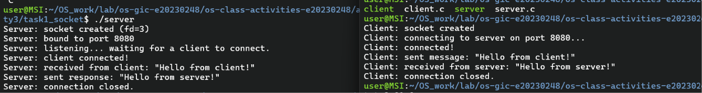
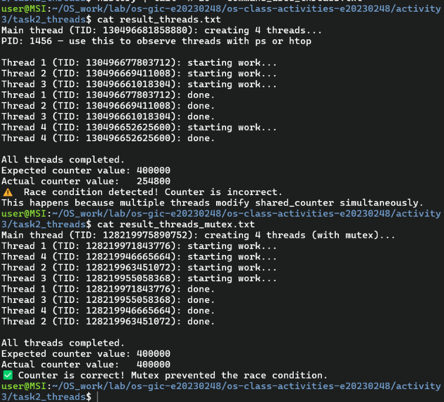
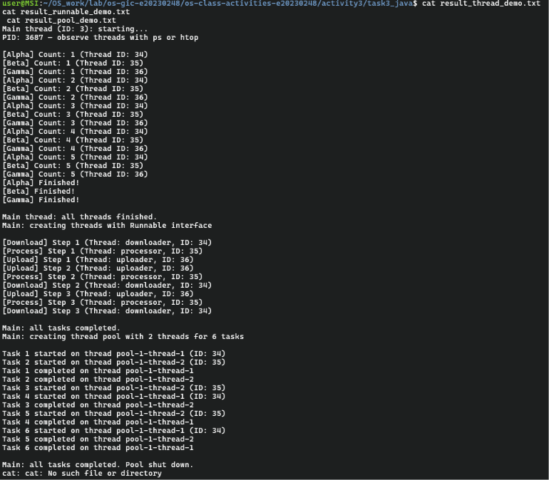
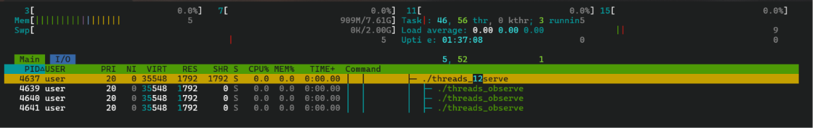
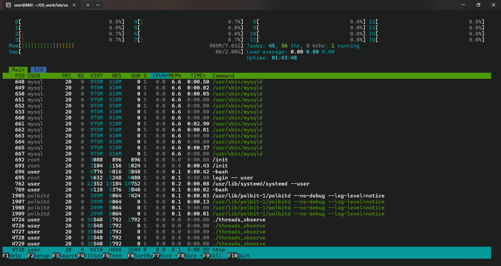
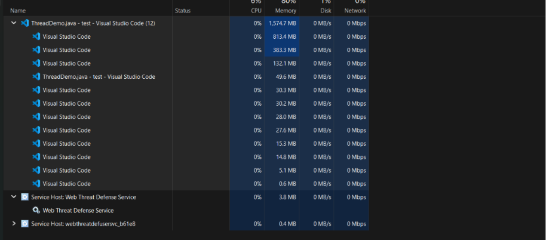

# Class Activity 3 — Socket Communication & Multithreading

- **Student Name:** CHEA Piseth
- **Student ID:** e20230248
- **Date:** 16/11/2026

---

## Task 1: TCP Socket Communication (C)

### Compilation & Execution



### Answers

1. **Role of `bind()` / Why client doesn't call it:**

   > - **Role of `bind()`:** It assigns a specific local IP address and port number (such as port `8080` in the server output) to a newly created socket file descriptor so incoming client connections know where to reach the server.
   > - **Why the client doesn't call it:** A client actively initiates connections rather than waiting passively on a well-known port. When the client calls `connect()`, the operating system automatically assigns an available ephemeral (temporary) local port and appropriate local IP interface to the client socket.

2. **What `accept()` returns:**

   > `accept()` extracts the first pending connection request from the listening queue and returns a **new socket file descriptor** dedicated exclusively to communicating (`read()`/`recv()` and `write()`/`send()`) with that specific connected client (or `-1` on error). Meanwhile, the original listening socket (such as `fd=3` in the server output) remains open to continue accepting future client connections.

3. **Starting client before server:**

   > If the client runs before the server has bound and called `listen()` on port `8080`, the client's `connect()` call fails immediately with a **"Connection refused" (`ECONNREFUSED`)** error. Because no socket is listening on that port, the OS kernel rejects the client's TCP `SYN` packet (typically by replying with a TCP `RST`).

4. **What `htons()` does:**

   > `htons()` (**Host TO Network Short**) converts a 16-bit unsigned integer (such as a TCP port number like `8080`) from the host CPU's native byte order (often little-endian on x86/ARM architectures) to **network byte order**, which is standardized as **big-endian** across TCP/IP protocols. This ensures machines with different endianness interpret port numbers consistently.

5. **Socket call sequence diagram:**

   > ```text
   > TCP Server                                   TCP Client
   > ----------                                   ----------
   >  socket()                                     socket()
   >     |                                            |
   >   bind()                                         |
   >     |                                            |
   >  listen()                                        |
   >     |                                            |
   >  accept()  <--- TCP 3-Way Handshake ---      connect()
   > (blocks until                                    |
   > client connects)                                 |
   >     |                                            |
   > read()/recv()  <--- "Hello from client!" --- write()/send()
   >     |                                            |
   > write()/send() --- "Hello from server!" ---> read()/recv()
   >     |                                            |
   >  close()                                      close()
   > ```

---

## Task 2: POSIX Threads (C)

### Output — Without Mutex (Race Condition)



### Output — With Mutex (Correct)

_(Include in the same screenshot or a separate one)_

### Answers

1. **What is a race condition?**

   > A race condition occurs when two or more threads access and modify shared data concurrently without synchronization, causing the final result to depend on unpredictable thread scheduling and interleaving. In the unlocked run, four threads increment `shared_counter` simultaneously; because read-modify-write operations are non-atomic and overwrite each other's updates, the final count reaches `254800` instead of the expected `400000`.

2. **What does `pthread_mutex_lock()` do?**

   > `pthread_mutex_lock()` acquires ownership of a mutual exclusion lock before a thread enters a **critical section**. If the mutex is unlocked, the calling thread locks it and proceeds; if another thread already holds the lock, the calling thread blocks until the owner calls `pthread_mutex_unlock()`. This enforces mutually exclusive access to `shared_counter`, preventing lost updates and ensuring the final value reaches `400000`.

3. **Removing `pthread_join()`:**

   > `pthread_join()` causes the main thread to wait until each worker thread finishes execution. If `pthread_join()` is removed, the main thread immediately prints `shared_counter` while worker threads are still running (producing an incomplete value) and returns from `main()`. Exiting `main()` terminates the entire process, abruptly killing any still-running worker threads before they finish.

4. **Thread vs Process:**

   > | Feature                       | Process                                                                         | Thread                                                                                               |
   > | :---------------------------- | :------------------------------------------------------------------------------ | :--------------------------------------------------------------------------------------------------- |
   > | **Memory Space**              | Isolated virtual address space (separate code, heap, data, and stack)           | Shares code, global data, heap, and open files with sibling threads; has its own stack and registers |
   > | **Creation & Context Switch** | Heavier overhead (requires duplicating/switching page tables and OS structures) | Lightweight (shares the parent process's memory mappings)                                            |
   > | **Communication**             | Requires explicit Inter-Process Communication (pipes, sockets, shared memory)   | Direct communication via shared variables in memory                                                  |
   > | **Fault & Data Isolation**    | High isolation; one crashing process does not directly corrupt another          | Low isolation; an unhandled crash terminates the whole process, and shared data requires locks       |

---

## Task 3: Java Multithreading

### ThreadDemo Output



### RunnableDemo Output

_(Include output or screenshot)_

### PoolDemo Output

_(Include output or screenshot)_

### Answers

1. **Thread vs Runnable:**

   > - **`Thread` (class):** Subclassing `java.lang.Thread` couples the task logic directly with the thread object itself. Because Java only allows single class inheritance, extending `Thread` prevents the class from extending any other base class.
   > - **`Runnable` (interface):** Implementing `java.lang.Runnable` separates the unit of work (`run()`) from the thread execution mechanism, allowing the task to be passed to a `Thread` constructor or a thread pool while keeping the class free to extend another class.

2. **Pool size limiting concurrency:**

   > A fixed-size thread pool caps the number of threads executing simultaneously and places excess tasks into a waiting queue until a worker thread becomes available. In `PoolDemo`, a pool of **2 threads** (`pool-1-thread-1` and `pool-1-thread-2`) executes **6 tasks**: Tasks 1 and 2 run concurrently first, while Tasks 3–6 wait in the queue and execute only as threads finish earlier tasks. This bounds CPU and memory usage and prevents excessive context switching under heavy load.

3. **thread.join() in Java:**

   > `thread.join()` blocks the calling thread (such as `main`) until the target thread completes its `run()` method and enters the `TERMINATED` state. In `ThreadDemo` and `RunnableDemo`, calling `join()` guarantees that the main thread waits for all worker threads to finish before printing `"Main thread: all threads finished."` or `"Main: all tasks completed."`.

4. **ExecutorService advantages:**

   > - **Thread reuse:** Reuses a pool of existing worker threads rather than incurring the overhead of creating and destroying a new OS thread for every task.
   > - **Resource & concurrency control:** Bounds the maximum number of active threads, preventing memory exhaustion and thread thrashing.
   > - **Built-in task queuing and scheduling:** Automatically manages task queues and supports delayed or periodic execution (`ScheduledExecutorService`).
   > - **Richer task management:** Supports `Callable<T>` and `Future<T>` for returning results and propagating exceptions asynchronously, alongside structured lifecycle shutdown methods (`shutdown()`, `awaitTermination()`).

---

## Task 4: Observing Threads

### Linux — `ps -eLf` Output

_(Paste the relevant ps output here)_

### Linux — htop Thread View



### Linux — htop Kernel Threads (tree view, `kthreadd`)



_(Paste the output of `ps -L ...` and `ps --ppid 2 ...` here)_

### Windows — Task Manager



### Answers

1. **LWP column meaning:**

   > `LWP` stands for **Light Weight Process**. In the Linux kernel, every thread is represented internally as a schedulable lightweight process (`task_struct`) that shares memory and file descriptors with its parent process. The `LWP` column displays each individual thread's unique kernel **Thread ID (TID)**, while `PID` displays the shared Process ID (Thread Group ID) and `NLWP` displays the total thread count in that process.

2. **/proc/PID/task/ count:**

   > In Linux's virtual `/proc` filesystem, `/proc/<PID>/task/` contains one subdirectory named after each active thread's TID (`LWP`) belonging to that process. Counting the directories inside `/proc/<PID>/task/` (e.g., via `ls /proc/<PID>/task | wc -l`) gives the exact number of threads (`NLWP`) currently running in that process—such as `5` entries for `./threads_observe` (1 main thread plus 4 worker threads, matching IDs `4724` and `4726`–`4729` in `htop`).

3. **Extra Java threads:**

   > Even a small Java program like `ThreadDemo` runs inside the **Java Virtual Machine (JVM)**, which automatically creates several internal system/daemon threads alongside `main` and the user-created threads (`Alpha`, `Beta`, `Gamma`). These extra threads include:
   >
   > - **Garbage Collector (GC) threads** (e.g., `GC Thread#0`, `G1 Main Marker`, `G1 Conc#0`) for automatic heap memory management.
   > - **JIT Compiler threads** (`C1 CompilerThread0`, `C2 CompilerThread0`) that compile hot bytecode into native machine instructions at runtime.
   > - **JVM housekeeping & signal threads** (`VM Thread`, `Reference Handler`, `Finalizer`, `Signal Dispatcher`, `Common-Cleaner`) for reference cleanup and OS signal handling.

4. **Linux vs Windows thread viewing:**

   > - **Linux (`ps -eLf`, `htop`, `/proc`):** Linux treats threads as first-class schedulable tasks (`LWP`s) with their own system-wide TIDs. `ps -eLf` lists every thread on a separate line, `htop` can expand processes to show individual green worker threads, and `/proc/<PID>/task/<TID>` exposes per-thread metadata directly.
   > - **Windows (Task Manager):** Windows encapsulates threads inside process objects, and Task Manager's default **Processes** tab displays child _processes_ (such as Visual Studio Code's 12 sub-processes) rather than threads. To view thread information in Task Manager, you must open the **Details** tab and enable the **Threads** column (which shows only the numeric thread count per process); inspecting individual Thread IDs on Windows requires **Resource Monitor** or **Sysinternals Process Explorer**.

5. **kthreadd and three kernel threads:**

   > - **`kthreadd` (PID 2):** `kthreadd` is the Linux **kernel thread daemon**. Spawned at boot directly by the kernel, it acts as the parent (`PPID = 2`) for all kernel-space threads, creating and managing kernel worker threads on demand. _(Note: Inside WSL2, `kthreadd` runs in the underlying utility VM root namespace rather than the distro's PID namespace, which is why `htop` shows `0 kthr` inside WSL, whereas native Linux displays `kthreadd` and its child threads.)_
   > - **Three common kernel threads:**
   >   1. **`ksoftirqd/<cpu>`:** Executes deferred software interrupts (softirqs) per CPU core so hardware interrupts are not blocked under heavy network or I/O load.
   >   2. **`kworker/<cpu>:<id>`:** Worker threads that process asynchronous kernel workqueues (deferred driver tasks, filesystem operations, and system events).
   >   3. **`kswapd0`:** The virtual memory management daemon that reclaims inactive memory pages and handles swapping when free RAM runs low.

6. **TID equal to PID, NLWP and cores:**

   > - **Why one TID equals PID:** In Linux, the **main thread** created when a process starts is assigned a Thread ID (`TID` / `LWP`) equal to the Process ID (`PID` / Thread Group ID). Additional threads created with `pthread_create()` receive new unique TIDs while sharing that same `PID` (for example, in `htop`, the main `./threads_observe` thread has ID `4724`, while its 4 worker threads have IDs `4726`–`4729`).
   > - **`NLWP` and CPU cores:** `NLWP` (**Number of Light Weight Processes**) is the software thread count of a process, which is not restricted by the hardware core count (this system has **16 logical CPU cores**, `0`–`15`, while `./threads_observe` has `NLWP = 5`). When `NLWP <= cores`, all runnable threads can execute simultaneously in true hardware parallelism; when `NLWP > cores`, the OS scheduler uses preemptive time-slicing and context switching to share the cores among threads.

7. **`H` and `K` in htop:**

   > - **`H` (Shift + H):** Toggles the visibility of **user-space threads** (hide/show user threads). When enabled, worker threads spawned by a process appear as separate rows (typically colored green).
   > - **`K` (Shift + K):** Toggles the visibility of **kernel threads** (hide/show kernel threads such as `kthreadd` and `kworker`).

---

## Reflection

> What I found most interesting about socket communication and threading was seeing how high-level abstractions in C and Java map directly down to concrete operating system mechanisms. Watching a TCP server block on `accept()` until a client completes the three-way handshake made network I/O feel tangible, while seeing the unlocked C threads lose nearly 150,000 increments due to a race condition demonstrated immediately why synchronization primitives like `pthread_mutex_lock()` are essential. Observing those exact same threads live in `htop` as individual LWPs alongside the JVM's background GC and compiler threads bridged the gap between application code and OS scheduling.
>
> Understanding threads at the OS level helps me write better concurrent programs because I can reason about real execution costs and failure modes rather than treating threads as magic. Knowing that threads share heap and global memory clarifies when locks or atomic operations are mandatory to prevent data corruption, while understanding context switching, core counts, and thread creation overhead explains why bounded thread pools (`ExecutorService`) outperform spawning unbounded threads in production systems.
