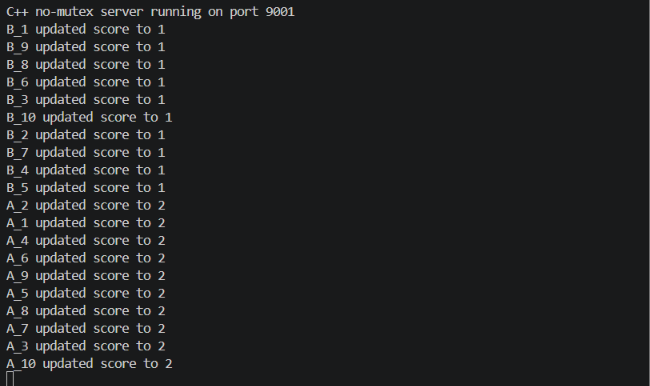
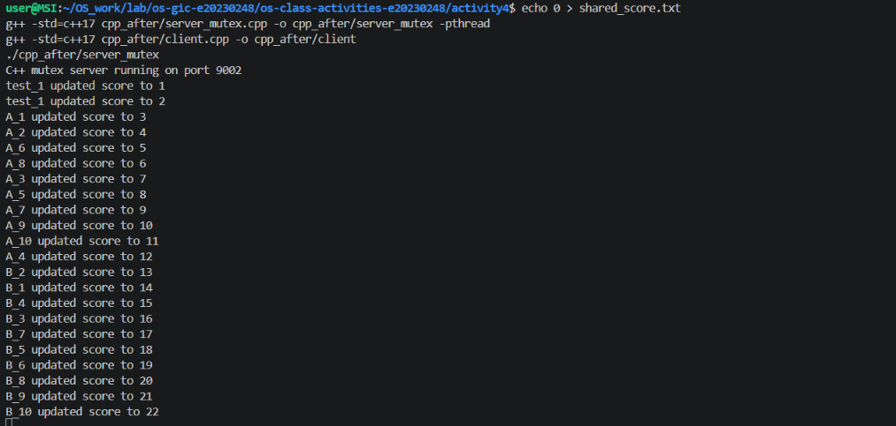
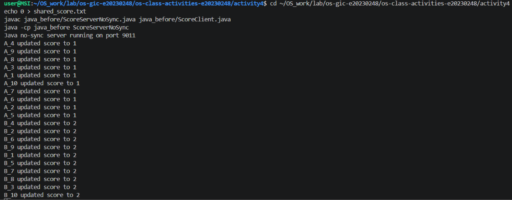
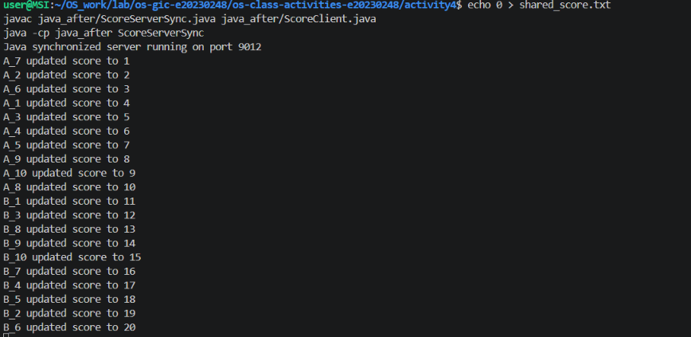

# Class Activity 4 — Shared File API

- **Student Name:** CHEA Piseth
- **Student ID:** e20230248
- **Server Machine Owner:** MSI
- **Server IP Address:** 172.27.112.168

---

## Task 1: C++ Before Mutex

- **Expected score after 20 total client requests:** 20
- **Actual score:** 2
- **What happened:** Without synchronization, multiple detached server threads read and wrote `shared_score.txt` concurrently. All 10 `B` client requests read `0` at the same time before any thread finished its 200 ms sleep and wrote `1`. Afterward, all 10 `A` client requests read `1` concurrently and overwrote the file with `2`, resulting in a race condition that lost 18 increments.

---

## Task 2: C++ After Mutex

- **Expected score after 20 total client requests:** 20
- **Actual score:** 20 _(22 in screenshot due to 2 earlier `test_1` test requests)_
- **What changed after adding mutex:** Adding `std::lock_guard<std::mutex> lock(file_mutex);` inside `update_score()` enforced mutual exclusion on the critical section so only one thread could read, sleep, increment, and write `shared_score.txt` at a time. Every client request incremented the score sequentially without overwriting another thread's update.

---

## Task 3: Java Before Synchronized

- **Expected score after 20 total client requests:** 20
- **Actual score:** 2
- **What happened:** Because `updateScore()` in `ScoreServerNoSync.java` is not `synchronized`, multiple threads read and wrote `shared_score.txt` concurrently. All 10 `A` client requests read `0` before any thread finished its 200 ms `Thread.sleep(200)` pause and overwrote the file with `1`. Next, all 10 `B` client requests read `1` at the same time and overwrote `shared_score.txt` with `2`, causing a race condition that lost 18 increments.

---

## Task 4: Java After Synchronized

- **Expected score after 20 total client requests:** 20
- **Actual score:** 20
- **What changed after adding synchronized:** Declaring `updateScore()` with the `synchronized` keyword (`private static synchronized int updateScore(...)`) acquired the class-level intrinsic lock so only one thread could execute the critical section at a time. Each client thread waited its turn to read, sleep for 200 ms, increment, and write the updated value to `shared_score.txt`, eliminating lost updates and producing the exact final score of 20.

## Questions

1. **Why should clients send requests to the server instead of writing the file directly?**
   Centralizing file access through a single server API prevents multiple independent client processes—potentially running on different machines—from opening, modifying, and overwriting `shared_score.txt` simultaneously without coordination. It also enforces a single controlled entry point for managing concurrent access and maintaining data integrity.

2. **Why does the server still have a race condition before mutex or synchronized?**
   Even though only one server program touches `shared_score.txt`, the server spawns a separate worker thread for every incoming client connection (`std::thread` in C++ and `new Thread(...)` in Java). Without synchronization, multiple server threads execute the read-modify-write cycle concurrently—reading the same old value before the 200 ms sleep finishes and overwriting each other's updates.

3. **In the C++ fixed version, what does `std::lock_guard<std::mutex>` protect?**
   `std::lock_guard<std::mutex> lock(file_mutex);` protects the critical section inside `update_score()`, which includes reading `shared_score.txt`, sleeping for 200 ms, incrementing `score`, writing the updated score back to `shared_score.txt`, and printing the log message. Using RAII, it locks `file_mutex` when a thread enters `update_score()` and automatically unlocks it when the function exits, ensuring only one thread modifies the file at a time.

4. **In the Java fixed version, what does `synchronized` protect?**
   Declaring `private static synchronized int updateScore(...)` protects the entire `updateScore` method as a critical section using the class-level intrinsic lock (`ScoreServerSync.class`). Only one thread at a time can enter the method to read `shared_score.txt`, sleep for 200 ms, increment the score, and write the new value back to the file.

5. **Why is the final score expected to be 20 when Student A sends 10 requests and Student B sends 10 requests?**
   The file `shared_score.txt` is initialized to `0`, and each client request increments the score by `1` (`score++`). When Student A sends 10 requests and Student B sends 10 requests ($10 + 10 = 20$ total requests), proper synchronization prevents lost updates so every increment is applied sequentially, resulting in $0 + 20 = 20$.

6. **What could happen if two separate servers update the same file at the same time?**
   A race condition and lost updates (or file corruption) would occur again. Both `std::mutex` in C++ and `synchronized` in Java only coordinate threads within the same process memory space; two separate server processes do not share those locks and could read stale values or overwrite each other's writes unless OS-level file locking (such as `flock` or `fcntl`) is used.

---

## Reflection

Comparing both implementations highlights two different ways of achieving mutual exclusion: C++ requires explicitly declaring a `std::mutex` (`file_mutex`) and binding it to a scope with `std::lock_guard<std::mutex>` (RAII) so the lock is safely released when the function returns, whereas Java integrates synchronization directly into the language via the `synchronized` keyword on the `static` method, which automatically acquires and releases the class monitor lock. Despite the syntax differences, both mechanisms produced the exact same behavior—fixing the lost updates seen in our unsynchronized runs (where the score stalled at `2`) and reliably reaching `20`. This activity demonstrated that funneling requests through a single server is not enough on its own when the server is multithreaded; any shared resource accessed by concurrent threads must have its read-modify-write critical section explicitly synchronized.
